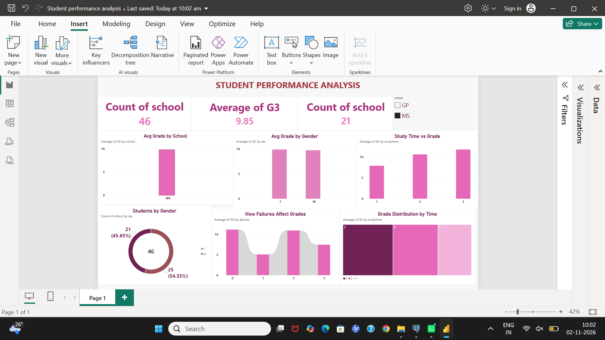

# Student Performance Analysis
PostgreSQL (pgAdmin) + Power BI

## Files
- SQL File: Student_perofrmance.sql - AVG, GROUP BY, COUNT queries
- Power BI File: Student performance analysis.pbix
- Data: student_data.csv.xlsx
- Dashboard: Student_Performance_Analysis.png

## Dashboard Insights
Avg Grade 9.85 | 395 Students | GP & MS Schools | Study time & Failures impact on grades

